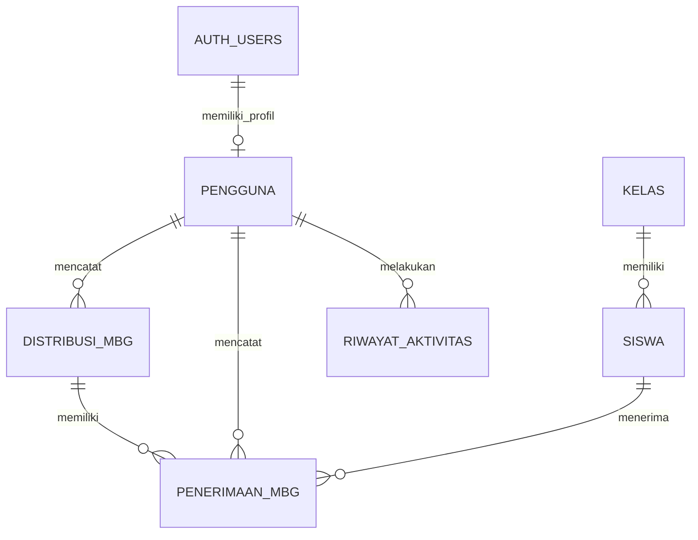

# PRODUCT REQUIREMENTS DOCUMENT (PRD)

# MBG Tracker

## Sistem Monitoring Penerimaan Makan Bergizi Gratis

  Informasi        Keterangan
  ---------------- ---------------------------------------------
  Nama produk      MBG Tracker
  Versi dokumen    1.1
  Status           Draft spesifikasi produk untuk pengembangan
  Platform         Web responsif
  Cakupan awal     Satu sekolah
  Bahasa           Indonesia
  Zona waktu       Asia/Jakarta (WIB)
  Pengguna utama   Siswa, guru/petugas MBG, administrator

------------------------------------------------------------------------

## 1. Ringkasan Produk

MBG Tracker adalah aplikasi berbasis web untuk mencatat dan memantau
kedatangan serta penerimaan Makan Bergizi Gratis (MBG) di satu sekolah.

Siswa mengakses aplikasi melalui QR Code statis atau tautan sekolah.
Setelah status MBG dinyatakan sudah tiba oleh guru, siswa mencari
identitasnya menggunakan nama lengkap, dengan pilihan filter kelas dan
jurusan untuk membedakan siswa yang memiliki nama serupa. Siswa kemudian
mengonfirmasi bahwa ia telah menerima MBG.

Guru dapat mencatat kedatangan MBG, mengonfirmasi penerimaan satu siswa,
atau melakukan konfirmasi massal berdasarkan kelas. Administrator
mengelola data induk, akun, pengaturan, dan laporan.

Sistem menyimpan tanggal, waktu hingga detik, identitas siswa, kelas,
jurusan, sekolah, serta sumber pencatatan. Laporan dapat digunakan untuk
melihat jumlah siswa yang sudah dan belum tercatat menerima MBG.

### 1.1 Tujuan Produk

1.  Mengetahui siswa yang sudah dan belum tercatat menerima MBG pada
    suatu hari distribusi.
2.  Mencatat waktu kedatangan MBG di sekolah.
3.  Mencatat waktu konfirmasi penerimaan setiap siswa hingga presisi
    detik.
4.  Memudahkan guru mencatat penerimaan secara individu maupun massal
    per kelas.
5.  Menyediakan rekap distribusi berdasarkan tanggal, siswa, kelas, dan
    jurusan.
6.  Mengurangi pencatatan manual dan memudahkan penelusuran perubahan
    data.

### 1.2 Sasaran Pengguna

-   **Siswa:** melakukan pencarian identitas dan konfirmasi penerimaan.
-   **Guru/petugas MBG:** mencatat kedatangan, mengonfirmasi penerimaan,
    dan memantau laporan operasional.
-   **Administrator:** mengelola data induk, akun, QR Code, pengaturan,
    dan seluruh laporan.

### 1.3 Batasan Versi Awal

-   Aplikasi digunakan untuk satu sekolah.
-   Aplikasi berbasis web responsif, bukan aplikasi Android/iOS native.
-   Siswa tidak perlu membuat akun untuk melakukan konfirmasi.
-   QR Code bersifat statis dan mengarah ke tautan halaman siswa.
-   Identifikasi siswa menggunakan pencarian nama, dengan filter kelas
    dan jurusan.
-   Guru menjadi pihak yang mencatat waktu kedatangan MBG.
-   Satu kegiatan distribusi harian menjadi skenario standar versi awal.
-   Integrasi WhatsApp, multi-sekolah, dan aplikasi native berada di
    luar ruang lingkup MVP.

------------------------------------------------------------------------

## 2. Aktor, Peran, dan Hak Akses

### 2.1 Siswa

Siswa dapat: - Membuka halaman siswa melalui QR Code atau tautan. -
Melihat status kedatangan MBG hari itu. - Mencari nama lengkap. -
Memfilter hasil berdasarkan kelas dan jurusan. - Melihat nama, kelas,
dan jurusan sebagai pembeda identitas. - Memilih identitas yang benar. -
Mengonfirmasi bahwa dirinya sudah menerima MBG. - Melihat hasil
konfirmasi atau informasi bahwa dirinya sudah tercatat.

Siswa tidak dapat: - Mengubah data induk siswa. - Melihat NISN, email,
atau nomor HP siswa lain. - Mengonfirmasi penerimaan sebelum MBG
dinyatakan tiba. - Mengubah atau menghapus transaksi penerimaan.

### 2.2 Guru/Petugas MBG

Guru dapat: - Login menggunakan akun. - Mencatat status dan waktu
kedatangan MBG. - Melihat daftar siswa dan kelas. - Melakukan konfirmasi
penerimaan individu. - Memilih kelas untuk konfirmasi massal. - Melihat
seluruh siswa dalam kelas terpilih. - Meng-unselect siswa yang tidak
menerima. - Melihat daftar siswa yang akan dicatat sebelum menyimpan. -
Melihat dashboard dan laporan operasional. - Melihat riwayat penerimaan.

Hak koreksi transaksi guru dapat diatur melalui kebijakan administrator.
Rekomendasi awal: koreksi transaksi hanya dapat dilakukan administrator.

### 2.3 Administrator

Administrator dapat: - Login ke dashboard administrator. - Mengelola
data siswa, kelas, dan jurusan. - Mengimpor data siswa. - Mengelola akun
guru dan hak akses. - Mengelola pengaturan distribusi. - Mengakses dan
mengelola QR Code statis. - Melihat seluruh dashboard dan laporan. -
Melakukan koreksi data sesuai kewenangan. - Melihat audit log. - Menutup
distribusi harian.

### 2.4 Matriks Hak Akses

  Fitur                             Siswa             Guru   Administrator
  ------------------------------- ------- ---------------- ---------------
  Membuka halaman QR                   Ya               Ya              Ya
  Mencari identitas siswa              Ya               Ya              Ya
  Konfirmasi penerimaan sendiri        Ya      Tidak wajib     Tidak wajib
  Konfirmasi individu siswa         Tidak               Ya              Ya
  Konfirmasi massal per kelas       Tidak               Ya              Ya
  Input kedatangan MBG              Tidak               Ya              Ya
  Melihat dashboard                 Tidak               Ya              Ya
  Mengelola siswa                   Tidak      Sesuai izin              Ya
  Mengelola kelas/jurusan           Tidak            Tidak              Ya
  Mengelola akun pengguna           Tidak            Tidak              Ya
  Koreksi transaksi                 Tidak      Sesuai izin              Ya
  Melihat audit log                 Tidak   Terbatas/tidak              Ya
  Menutup distribusi                Tidak      Sesuai izin              Ya

------------------------------------------------------------------------

## 3. Alur Bisnis Utama

### 3.1 Alur Siswa Melalui QR Code

1.  Siswa membuka kamera pada ponsel.
2.  Siswa memindai QR Code statis yang dipasang sekolah atau membuka
    tautan langsung.
3.  Browser membuka halaman MBG Tracker.
4.  Sistem memeriksa status distribusi untuk tanggal berjalan.
5.  Jika MBG belum dinyatakan tiba, sistem menampilkan halaman informasi
    bahwa MBG belum datang dan siswa diminta menunggu serta menghubungi
    guru.
6.  Jika MBG sudah tiba, sistem menampilkan formulir pencarian siswa.
7.  Siswa memasukkan nama lengkap.
8.  Siswa dapat memilih filter kelas dan jurusan.
9.  Sistem menampilkan kandidat yang sesuai.
10. Setiap kandidat menampilkan nama, kelas, dan jurusan.
11. Siswa memilih identitas yang benar.
12. Sistem menampilkan ringkasan identitas untuk diperiksa.
13. Siswa menekan tombol **"Saya Sudah Menerima MBG"**.
14. Server memvalidasi status distribusi dan memeriksa apakah siswa
    sudah memiliki transaksi.
15. Jika valid, sistem menyimpan transaksi dengan waktu server.
16. Sistem menampilkan notifikasi bahwa penerimaan berhasil dicatat.

### 3.2 Halaman Saat MBG Belum Tiba

Halaman menampilkan: - Identitas aplikasi MBG Tracker. - Status "MBG
Belum Tiba". - Informasi bahwa kedatangan belum dicatat oleh guru. -
Arahan untuk menunggu dan mengonfirmasi kepada guru/petugas yang
bertanggung jawab. - Tombol untuk memeriksa kembali status.

Dalam kondisi ini, pencarian dan tombol konfirmasi penerimaan tidak
tersedia.

### 3.3 Halaman Pencarian dan Konfirmasi Siswa

Judul halaman: **Konfirmasi Penerimaan**

Teks pengantar: "Masukkan nama lengkap Anda untuk mencari data siswa.
Pilih kelas dan jurusan untuk membantu membedakan nama yang serupa."

Kolom yang tersedia:

  Kolom          Ketentuan
  -------------- ------------------------------------------
  Nama lengkap   Kolom pencarian utama
  Kelas          Filter opsional, default "Semua kelas"
  Jurusan        Filter opsional, default "Semua jurusan"

Hasil pencarian menampilkan: - Nama lengkap siswa. - Kelas. - Jurusan.

NISN, email, dan nomor HP tidak ditampilkan pada hasil pencarian publik.

Jika nama sama, siswa dapat membedakan kandidat berdasarkan kelas dan
jurusan. Jika kandidat masih belum jelas, siswa diarahkan untuk meminta
bantuan guru.

### 3.4 Alur Konfirmasi Individu oleh Guru

1.  Guru login.
2.  Guru membuka menu konfirmasi individu.
3.  Guru mencari siswa berdasarkan nama, kelas, atau NISN.
4.  Sistem menampilkan identitas siswa.
5.  Guru memastikan identitas dan status siswa.
6.  Guru memilih tindakan konfirmasi penerimaan.
7.  Sistem meminta konfirmasi akhir.
8.  Server menyimpan transaksi, waktu, dan identitas guru.
9.  Dashboard dan laporan diperbarui.

### 3.5 Alur Konfirmasi Massal Berdasarkan Kelas

1.  Guru login.
2.  Guru membuka menu konfirmasi kelas.
3.  Guru memilih kelas.
4.  Sistem mengambil seluruh siswa aktif dalam kelas tersebut.
5.  Secara default seluruh siswa yang belum memiliki transaksi pada
    distribusi hari itu dipilih.
6.  Guru dapat meng-unselect siswa yang tidak menerima MBG.
7.  Sistem menampilkan jumlah siswa terpilih dan daftar nama yang akan
    dicatat.
8.  Guru meninjau daftar tersebut.
9.  Guru menekan tombol konfirmasi.
10. Sistem menampilkan konfirmasi akhir berisi daftar siswa terpilih.
11. Server memproses transaksi untuk setiap siswa yang valid.
12. Setiap transaksi menyimpan timestamp server dan identitas guru
    sebagai pencatat.
13. Sistem menampilkan ringkasan jumlah transaksi berhasil dan transaksi
    yang dilewati karena sudah tercatat atau tidak valid.

Konfirmasi massal merupakan pencatatan oleh guru, bukan bukti bahwa
setiap siswa melakukan scan atau konfirmasi sendiri. Sumber pencatatan
harus disimpan secara eksplisit.

### 3.6 Alur Kedatangan MBG

1.  Guru login.
2.  Guru membuka menu "Kedatangan MBG".
3.  Sistem menampilkan tanggal distribusi berjalan.
4.  Guru menekan tombol "MBG Sudah Tiba".
5.  Guru memasukkan atau mengonfirmasi waktu kedatangan aktual.
6.  Sistem menyimpan waktu kejadian, waktu pencatatan, dan identitas
    guru.
7.  Status distribusi berubah menjadi `arrived`.
8.  Halaman siswa mulai menyediakan fitur pencarian dan konfirmasi.

Sistem perlu membedakan waktu kejadian kedatangan dengan waktu
pencatatan oleh guru. Jika guru terlambat menginput, kedua waktu
tersebut tidak boleh dianggap sama.

### 3.7 Penutupan Distribusi

Guru yang diberi kewenangan atau administrator dapat menutup distribusi
harian. Setelah ditutup: - Siswa tidak dapat membuat transaksi
penerimaan baru. - Guru tidak dapat menambahkan transaksi biasa. -
Koreksi setelah penutupan hanya dapat dilakukan oleh pihak berwenang. -
Semua koreksi harus tercatat dalam audit log.

------------------------------------------------------------------------

## 4. Struktur Menu

### 4.1 Menu Guru

1.  Dashboard
2.  Kedatangan MBG
3.  Konfirmasi Individu
4.  Konfirmasi Kelas
5.  Data Siswa
6.  Laporan
7.  Profil/Akun

### 4.2 Menu Administrator

1.  Dashboard
2.  Kedatangan dan Distribusi MBG
3.  Konfirmasi Individu
4.  Konfirmasi Kelas
5.  Data Siswa
6.  Manajemen Kelas
7.  Manajemen Jurusan
8.  Manajemen Guru
9.  Pengaturan QR Code
10. Laporan
11. Audit Log
12. Pengaturan Aplikasi

------------------------------------------------------------------------

## 5. Dashboard

### 5.1 Tujuan

Dashboard harus memberi gambaran kondisi distribusi dalam beberapa
detik. Antarmuka ditujukan untuk guru yang membutuhkan teks besar,
tombol lebar, kontras tinggi, dan informasi operasional yang mudah
dipindai.

### 5.2 Kartu Statistik Utama

Dashboard menampilkan: - Total siswa aktif. - Total siswa sudah
menerima. - Total siswa belum tercatat menerima. - Persentase
penerimaan. - Status kedatangan MBG. - Waktu kedatangan MBG. - Waktu
penerimaan pertama. - Waktu penerimaan terakhir.

### 5.3 Informasi Tambahan

-   Rekap penerimaan per kelas.
-   Rekap penerimaan per jurusan.
-   Jumlah kelas yang sudah dan belum selesai.
-   Daftar siswa yang belum tercatat menerima.
-   Aktivitas penerimaan terbaru.
-   Sumber pencatatan: siswa atau guru.

### 5.4 Rumus Statistik

`Total belum tercatat menerima = Total siswa aktif yang masuk cakupan - Total siswa dengan transaksi penerimaan valid`

`Persentase penerimaan = (Total siswa dengan transaksi penerimaan valid / Total siswa aktif yang masuk cakupan) x 100%`

Status tidak hadir atau tidak mengambil MBG harus dipisahkan dari status
belum tercatat menerima agar laporan tidak menyesatkan.

------------------------------------------------------------------------

## 6. Kebutuhan Fungsional

  -----------------------------------------------------------------------
  ID                Fitur             Deskripsi         Prioritas
  ----------------- ----------------- ----------------- -----------------
  FR-01             QR Code statis    QR mengarah ke    Must
                                      tautan halaman    
                                      siswa             

  FR-02             Pencarian siswa   Pencarian nama    Must
                                      lengkap           

  FR-03             Filter kelas      Filter kandidat   Must
                                      berdasarkan kelas 

  FR-04             Filter jurusan    Filter kandidat   Must
                                      berdasarkan       
                                      jurusan           

  FR-05             Identitas         Menampilkan nama, Must
                    kandidat          kelas, dan        
                                      jurusan           

  FR-06             Status MBG        Memeriksa status  Must
                                      distribusi harian 

  FR-07             Halaman belum     Menampilkan       Must
                    tiba              informasi jika    
                                      MBG belum datang  

  FR-08             Konfirmasi siswa  Siswa mencatat    Must
                                      penerimaan        
                                      sendiri           

  FR-09             Anti duplikasi    Mencegah          Must
                                      transaksi ganda   

  FR-10             Kedatangan MBG    Guru mencatat     Must
                                      waktu kedatangan  

  FR-11             Konfirmasi        Guru mencatat     Must
                    individu          penerimaan satu   
                                      siswa             

  FR-12             Konfirmasi kelas  Guru memilih      Must
                                      seluruh siswa     
                                      dalam kelas       

  FR-13             Unselect siswa    Guru              Must
                                      mengecualikan     
                                      siswa tertentu    

  FR-14             Pratinjau massal  Sistem            Must
                                      menampilkan       
                                      daftar sebelum    
                                      disimpan          

  FR-15             Dashboard         Statistik         Must
                                      penerimaan dan    
                                      kedatangan        

  FR-16             Laporan harian    Rekap penerimaan  Must
                                      berdasarkan       
                                      tanggal           

  FR-17             Manajemen siswa   Tambah, ubah,     Must
                                      nonaktifkan, dan  
                                      impor siswa       

  FR-18             Manajemen kelas   CRUD kelas        Must

  FR-19             Manajemen jurusan CRUD jurusan      Must

  FR-20             Manajemen         Kelola akun guru  Must
                    pengguna          dan administrator 

  FR-21             Audit log         Catat aktivitas   Must
                                      dan perubahan     
                                      penting           

  FR-22             Export Excel      Unduh data        Should
                                      laporan           

  FR-23             Export PDF        Unduh laporan     Should
                                      dokumentasi       

  FR-24             Export CSV        Pertukaran data   Could

  FR-25             Penutupan         Mengunci          Must
                    distribusi        transaksi         
                                      distribusi        
  -----------------------------------------------------------------------

------------------------------------------------------------------------

## 7. Business Rules

### BR-01. Satu transaksi per siswa per distribusi

Seorang siswa hanya boleh memiliki satu catatan penerimaan valid untuk
satu kegiatan distribusi. Sistem menerapkan unique constraint pada
kombinasi distribusi dan siswa.

### BR-02. Status kedatangan sebagai prasyarat

Siswa hanya dapat mengonfirmasi setelah status distribusi berubah
menjadi `arrived` dan belum ditutup.

### BR-03. Timestamp dari server

Waktu transaksi penerimaan dibuat oleh server, bukan diambil dari jam
perangkat siswa. Penyimpanan menggunakan timestamp yang konsisten dan
ditampilkan dalam zona waktu Asia/Jakarta.

### BR-04. Waktu kedatangan

Sistem menyimpan: - Waktu kedatangan aktual yang dimasukkan atau
dikonfirmasi guru. - Waktu ketika data kedatangan dicatat oleh server. -
Identitas guru yang mencatat. - Riwayat koreksi jika ada.

### BR-05. Konfirmasi massal

Seluruh siswa aktif pada kelas terpilih yang belum memiliki transaksi
otomatis dipilih. Guru dapat meng-unselect siswa sebelum menyimpan.
Setiap siswa menjadi satu record penerimaan.

### BR-06. Transaksi yang sudah ada

Siswa yang sudah tercatat tidak menghasilkan transaksi baru. Dalam
konfirmasi massal, sistem melewati siswa tersebut dan melaporkan jumlah
yang dilewati.

### BR-07. Snapshot identitas historis

Pada saat transaksi dibuat, sistem menyimpan snapshot nama, NISN, kelas,
dan jurusan. Perubahan data siswa di kemudian hari tidak mengubah
identitas historis transaksi.

### BR-08. Status siswa

Status penerimaan dan status kehadiran/keikutsertaan harus dibedakan.

Status operasional yang disarankan: - `received`: sudah tercatat
menerima. - `not_received`: belum tercatat menerima. - `absent`: tidak
hadir. - `not_taking`: tidak mengambil MBG.

Status `not_received` merupakan kondisi belum ada transaksi, bukan
selalu berarti siswa menolak atau tidak menerima makanan.

### BR-09. Penutupan distribusi

Distribusi yang ditutup tidak menerima transaksi baru melalui alur
normal. Koreksi setelah penutupan harus memakai hak akses khusus dan
audit log.

### BR-10. Pencatatan sumber transaksi

Setiap penerimaan menyimpan sumber: - `student`: dikonfirmasi melalui
halaman siswa. - `teacher`: dicatat oleh guru.

### BR-11. Koreksi transaksi

Rekomendasi kebijakan awal: hanya administrator yang dapat mengoreksi
atau membatalkan transaksi. Koreksi tidak menghapus jejak transaksi
awal; perubahan dicatat dalam audit log.

### BR-12. Distribusi harian

Versi awal mengasumsikan satu kegiatan distribusi per tanggal sekolah.
Struktur database tetap menggunakan entitas distribusi agar pengembangan
sesi lebih dari satu kali per hari dapat dilakukan kemudian.

------------------------------------------------------------------------

## 8. Rancangan Database Supabase

Backend aplikasi menggunakan **Supabase**, dengan PostgreSQL sebagai database utama. Versi awal tetap menggunakan enam tabel inti berbahasa Indonesia. Supabase Auth digunakan untuk autentikasi guru dan administrator; siswa tidak diwajibkan memiliki akun.

Prinsip rancangan:
- Primary key menggunakan `UUID` (`gen_random_uuid()`), bukan `BIGINT`, agar konsisten dengan ekosistem Supabase dan Auth.
- Waktu disimpan sebagai `TIMESTAMPTZ` dalam UTC. Tampilan aplikasi mengonversi waktu ke `Asia/Jakarta`.
- Password tidak disimpan di tabel aplikasi. Password dan sesi dikelola oleh Supabase Auth.
- Kolom status menggunakan `TEXT` dengan `CHECK constraint` agar nilai yang diperbolehkan tetap terkendali.
- Tabel `pengguna.id` menggunakan UUID yang sama dengan `auth.users.id`.
- Aktifkan Row Level Security (RLS) pada seluruh tabel.
- Data identitas siswa tidak boleh dapat dibaca bebas oleh pengguna anonim melalui akses langsung ke tabel.

### 8.1 Tabel `pengguna`

Profil dan peran akun guru/admin. Baris dibuat setelah akun dibuat di Supabase Auth.

| Kolom | Tipe PostgreSQL | Keterangan |
|---|---|---|
| id | UUID PK, FK ke `auth.users.id` | ID akun autentikasi |
| nama | VARCHAR(150) | Nama pengguna |
| email | VARCHAR(150) | Email akun, disinkronkan dari Auth |
| peran | TEXT | `admin` atau `guru` |
| status_aktif | BOOLEAN | Status akun |
| dibuat_pada | TIMESTAMPTZ | Default `now()` |
| diperbarui_pada | TIMESTAMPTZ | Waktu perubahan |

Tidak ada kolom `kata_sandi`. Pembuatan akun dan reset password dilakukan melalui Supabase Auth. Pendaftaran publik dinonaktifkan; admin membuat atau mengundang akun guru melalui proses yang terkontrol.

### 8.2 Tabel `kelas`

| Kolom | Tipe PostgreSQL | Keterangan |
|---|---|---|
| id | UUID PK | ID kelas |
| nama_kelas | VARCHAR(50) | Contoh XI RPL 1 |
| tingkat | VARCHAR(10) | X, XI, atau XII |
| jurusan | VARCHAR(100) | Nama jurusan |
| status_aktif | BOOLEAN | Status kelas |
| dibuat_pada | TIMESTAMPTZ | Default `now()` |
| diperbarui_pada | TIMESTAMPTZ | Waktu perubahan |

Untuk satu sekolah, jurusan disimpan langsung di tabel `kelas` agar model data tetap sederhana.

### 8.3 Tabel `siswa`

| Kolom | Tipe PostgreSQL | Keterangan |
|---|---|---|
| id | UUID PK | ID siswa |
| nisn | VARCHAR(20) UNIQUE | NISN; wajib unik jika tersedia |
| nama | VARCHAR(150) | Nama lengkap |
| kelas_id | UUID FK ke `kelas.id` | Kelas siswa |
| email | VARCHAR(150), nullable | Email siswa |
| no_hp | VARCHAR(20), nullable | Nomor HP siswa |
| status_aktif | BOOLEAN | Status siswa |
| dibuat_pada | TIMESTAMPTZ | Default `now()` |
| diperbarui_pada | TIMESTAMPTZ | Waktu perubahan |

Buat indeks untuk `nama`, `kelas_id`, dan `nisn` agar pencarian lebih efisien. Email, nomor HP, dan NISN tidak ditampilkan pada hasil pencarian publik.

### 8.4 Tabel `distribusi_mbg`

| Kolom | Tipe PostgreSQL | Keterangan |
|---|---|---|
| id | UUID PK | ID distribusi |
| tanggal | DATE UNIQUE | Tanggal distribusi; satu distribusi per hari pada MVP |
| status | TEXT | `menunggu`, `tiba`, atau `ditutup` |
| waktu_kedatangan | TIMESTAMPTZ, nullable | Waktu aktual MBG tiba |
| waktu_input | TIMESTAMPTZ, nullable | Waktu guru mencatat kedatangan |
| petugas_id | UUID FK ke `pengguna.id` | Guru/admin pencatat |
| keterangan | TEXT, nullable | Catatan tambahan |
| dibuat_pada | TIMESTAMPTZ | Default `now()` |
| diperbarui_pada | TIMESTAMPTZ | Waktu perubahan |

Tambahkan `CHECK` constraint untuk status. `waktu_kedatangan` adalah waktu kejadian aktual yang dapat diinput guru; `waktu_input` diisi otomatis oleh database saat pencatatan dilakukan. Keduanya tidak boleh disamakan bila input terlambat.

### 8.5 Tabel `penerimaan_mbg`

| Kolom | Tipe PostgreSQL | Keterangan |
|---|---|---|
| id | UUID PK | ID catatan |
| distribusi_id | UUID FK ke `distribusi_mbg.id` | Distribusi terkait |
| siswa_id | UUID FK ke `siswa.id` | Siswa terkait |
| nama_siswa | VARCHAR(150) | Snapshot nama saat transaksi |
| nisn | VARCHAR(20), nullable | Snapshot NISN |
| kelas | VARCHAR(50) | Snapshot kelas |
| jurusan | VARCHAR(100) | Snapshot jurusan |
| status_penerimaan | TEXT | `diterima`, `tidak_hadir`, atau `tidak_mengambil` |
| waktu_penerimaan | TIMESTAMPTZ, nullable | Waktu penerimaan dari server |
| sumber_pencatatan | TEXT | `siswa` atau `guru` |
| petugas_id | UUID FK ke `pengguna.id`, nullable | Guru/admin pencatat bila sumbernya guru |
| dibuat_pada | TIMESTAMPTZ | Default `now()` |
| diperbarui_pada | TIMESTAMPTZ | Waktu perubahan |

Aturan:
- Terapkan unique constraint gabungan `(distribusi_id, siswa_id)` untuk mencegah duplikasi.
- Status `diterima` harus memiliki `waktu_penerimaan`; status lain tidak memiliki waktu penerimaan.
- `sumber_pencatatan` wajib bernilai `siswa` atau `guru`.
- Simpan snapshot identitas agar laporan historis tidak berubah ketika data induk siswa atau kelas diperbarui.
- Untuk pencatatan siswa, `petugas_id` bernilai `NULL`; untuk pencatatan guru, isi dengan ID pengguna yang sedang login.
- Transaksi siswa dan guru harus divalidasi di sisi server, bukan hanya melalui pemeriksaan pada antarmuka.

### 8.6 Tabel `riwayat_aktivitas`

| Kolom | Tipe PostgreSQL | Keterangan |
|---|---|---|
| id | UUID PK | ID aktivitas |
| pengguna_id | UUID FK ke `pengguna.id`, nullable | Pengguna yang melakukan aktivitas |
| aktivitas | VARCHAR(100) | Jenis aktivitas |
| tabel_terkait | VARCHAR(50) | Nama tabel terkait |
| data_id | UUID, nullable | ID record terkait |
| data_sebelum | JSONB, nullable | Data sebelum perubahan |
| data_sesudah | JSONB, nullable | Data setelah perubahan |
| waktu_aktivitas | TIMESTAMPTZ | Default `now()` |

Gunakan `JSONB` untuk data sebelum/sesudah. Aktivitas sistem yang dilakukan siswa anonim dapat memiliki `pengguna_id = NULL`; sumber tindakan tetap dapat dijelaskan melalui jenis aktivitas dan data terkait. Hindari menyimpan data pribadi berlebihan di audit log.

### 8.7 Relasi Antar Tabel



### 8.8 Indeks dan Constraint Minimum

- `pengguna.id` primary key sekaligus foreign key ke `auth.users(id)`.
- `siswa.nisn` unique jika NISN tersedia; bila data NISN kosong, gunakan unique index parsial untuk nilai yang tidak NULL.
- `siswa.kelas_id` foreign key ke `kelas.id`.
- `distribusi_mbg.tanggal` unique untuk membatasi satu distribusi per tanggal pada MVP.
- `penerimaan_mbg(distribusi_id, siswa_id)` unique.
- Index pada `siswa.nama`, `siswa.kelas_id`, `penerimaan_mbg.distribusi_id`, dan `penerimaan_mbg.siswa_id`.
- Tambahkan `CHECK` constraint untuk nilai status dan sumber pencatatan.
- Gunakan `ON DELETE RESTRICT` untuk data transaksi penting agar data historis tidak terhapus tanpa sengaja.

### 8.9 Catatan Implementasi SQL Supabase

Gunakan SQL Editor atau migration Supabase untuk membuat skema. Contoh pola tipe data dan constraint:

```sql
create extension if not exists pgcrypto;

create table public.pengguna (
  id uuid primary key references auth.users(id) on delete cascade,
  nama varchar(150) not null,
  email varchar(150) not null,
  peran text not null check (peran in ('admin', 'guru')),
  status_aktif boolean not null default true,
  dibuat_pada timestamptz not null default now(),
  diperbarui_pada timestamptz not null default now()
);

create table public.kelas (
  id uuid primary key default gen_random_uuid(),
  nama_kelas varchar(50) not null,
  tingkat varchar(10) not null,
  jurusan varchar(100) not null,
  status_aktif boolean not null default true,
  dibuat_pada timestamptz not null default now(),
  diperbarui_pada timestamptz not null default now(),
  unique (nama_kelas)
);

create table public.siswa (
  id uuid primary key default gen_random_uuid(),
  nisn varchar(20) unique,
  nama varchar(150) not null,
  kelas_id uuid not null references public.kelas(id) on delete restrict,
  email varchar(150),
  no_hp varchar(20),
  status_aktif boolean not null default true,
  dibuat_pada timestamptz not null default now(),
  diperbarui_pada timestamptz not null default now()
);

create table public.distribusi_mbg (
  id uuid primary key default gen_random_uuid(),
  tanggal date not null unique,
  status text not null default 'menunggu'
    check (status in ('menunggu', 'tiba', 'ditutup')),
  waktu_kedatangan timestamptz,
  waktu_input timestamptz,
  petugas_id uuid references public.pengguna(id) on delete restrict,
  keterangan text,
  dibuat_pada timestamptz not null default now(),
  diperbarui_pada timestamptz not null default now()
);

create table public.penerimaan_mbg (
  id uuid primary key default gen_random_uuid(),
  distribusi_id uuid not null references public.distribusi_mbg(id) on delete restrict,
  siswa_id uuid not null references public.siswa(id) on delete restrict,
  nama_siswa varchar(150) not null,
  nisn varchar(20),
  kelas varchar(50) not null,
  jurusan varchar(100) not null,
  status_penerimaan text not null
    check (status_penerimaan in ('diterima', 'tidak_hadir', 'tidak_mengambil')),
  waktu_penerimaan timestamptz,
  sumber_pencatatan text not null
    check (sumber_pencatatan in ('siswa', 'guru')),
  petugas_id uuid references public.pengguna(id) on delete restrict,
  dibuat_pada timestamptz not null default now(),
  diperbarui_pada timestamptz not null default now(),
  unique (distribusi_id, siswa_id),
  check (
    (status_penerimaan = 'diterima' and waktu_penerimaan is not null)
    or
    (status_penerimaan <> 'diterima' and waktu_penerimaan is null)
  )
);

create table public.riwayat_aktivitas (
  id uuid primary key default gen_random_uuid(),
  pengguna_id uuid references public.pengguna(id) on delete set null,
  aktivitas varchar(100) not null,
  tabel_terkait varchar(50) not null,
  data_id uuid,
  data_sebelum jsonb,
  data_sesudah jsonb,
  waktu_aktivitas timestamptz not null default now()
);

create index idx_siswa_nama on public.siswa (nama);
create index idx_siswa_kelas on public.siswa (kelas_id);
create index idx_penerimaan_distribusi on public.penerimaan_mbg (distribusi_id);
create index idx_penerimaan_siswa on public.penerimaan_mbg (siswa_id);
```

SQL di atas adalah fondasi skema, bukan keseluruhan konfigurasi keamanan. Kebijakan RLS, fungsi transaksi, trigger `diperbarui_pada`, dan fungsi server perlu ditambahkan sebelum aplikasi digunakan.

## 9. Modul Laporan

### 9.1 Laporan Harian

Menampilkan: - Tanggal distribusi. - Total siswa aktif dalam cakupan. -
Total siswa sudah menerima. - Total siswa belum tercatat menerima. -
Total tidak hadir. - Total tidak mengambil MBG. - Persentase
penerimaan. - Jam kedatangan. - Penerimaan pertama dan terakhir. - Rekap
per kelas dan jurusan.

### 9.2 Laporan Per Siswa

Kolom: - Tanggal distribusi. - Nama siswa. - NISN. - Kelas. - Jurusan. -
Status. - Jam penerimaan sampai detik. - Sumber konfirmasi. - Nama guru
pencatat, jika sumbernya guru.

### 9.3 Laporan Per Kelas

Menampilkan: - Nama kelas. - Jurusan. - Jumlah siswa aktif. - Jumlah
sudah menerima. - Jumlah belum tercatat menerima. - Jumlah tidak
hadir. - Jumlah tidak mengambil. - Persentase penerimaan. - Daftar siswa
yang belum tercatat menerima.

### 9.4 Laporan Historis

Filter: - Rentang tanggal. - Nama siswa. - NISN. - Kelas. - Jurusan. -
Status. - Sumber konfirmasi.

### 9.5 Export

Format yang direncanakan: - Excel (.xlsx) untuk pengolahan. - PDF untuk
dokumentasi. - CSV untuk pertukaran data.

Export harus mengikuti filter yang dipilih pengguna dan menerapkan hak
akses yang sama dengan halaman laporan.

------------------------------------------------------------------------

## 10. Kebutuhan Nonfungsional

  -----------------------------------------------------------------------
  Aspek                               Persyaratan
  ----------------------------------- -----------------------------------
  Responsive                          Nyaman digunakan di HP, tablet, dan
                                      desktop

  Performance                         Target halaman utama terbuka dalam
                                      3 detik pada koneksi normal

  Database                            Menjamin konsistensi dan integritas
                                      transaksi

  Security                            Password disimpan menggunakan
                                      hashing yang aman

  Authorization                       Hak akses berbasis peran

  Timestamp                           Pencatatan sampai detik menggunakan
                                      waktu server

  Timezone                            Asia/Jakarta

  Backup                              Backup database berkala dan uji
                                      pemulihan

  Audit                               Aktivitas penting dapat ditelusuri

  Usability                           Font besar, tombol lebar, navigasi
                                      sederhana

  Privacy                             Data pribadi tidak terekspos pada
                                      pencarian publik

  Reliability                         Penanganan kegagalan jaringan dan
                                      transaksi yang aman
  -----------------------------------------------------------------------

### 10.1 Keamanan dan Validasi Identitas

Pencarian nama dan QR statis tidak membuktikan bahwa orang yang
melakukan konfirmasi benar-benar siswa yang bersangkutan. Risiko
penyamaran identitas perlu dinyatakan secara terbuka.

Pengamanan minimum: - Hasil pencarian hanya menampilkan nama, kelas, dan
jurusan. - NISN, email, dan nomor HP tidak ditampilkan pada halaman
publik. - Batasi frekuensi pencarian dan percobaan konfirmasi. -
Validasi transaksi di server. - Cegah transaksi ganda melalui constraint
database. - Gunakan HTTPS. - Lindungi endpoint dari akses dan manipulasi
yang tidak sah. - Jangan menganggap QR statis sebagai autentikasi. -
Sediakan prosedur bantuan guru jika siswa tidak menemukan identitasnya.

Jika sekolah membutuhkan bukti identitas yang lebih kuat, verifikasi
tambahan dapat direncanakan pada tahap berikutnya.

### 10.2 Timestamp

-   Waktu transaksi penerimaan dibuat oleh server.
-   Jam perangkat siswa tidak menjadi sumber waktu utama.
-   Database menyimpan timestamp secara konsisten.
-   Tampilan waktu menggunakan zona Asia/Jakarta.
-   Waktu kedatangan aktual dibedakan dari waktu input guru.
-   Setiap koreksi timestamp harus meninggalkan jejak audit.

------------------------------------------------------------------------

## 11. Desain UI/UX

### 11.1 Identitas Visual

Arah visual: - Biru dominan terinspirasi identitas visual BSI. - Merah
sebagai warna aksen dan peringatan. - Putih sebagai latar utama. - Teks
navy atau abu-abu gelap untuk keterbacaan. - Hindari dekorasi
berlebihan, efek 3D, dan animasi yang tidak perlu.

Palet warna awal:

  Penggunaan   Warna        Kode
  ------------ ------------ -----------
  Primary      Biru         `#1769AA`
  Accent       Merah        `#C62836`
  Background   Putih        `#FFFFFF`
  Text         Navy gelap   `#172D50`
  Success      Hijau        `#21864B`
  Warning      Oranye       `#D97706`

### 11.2 Prinsip UX

1.  Guru dapat memahami status distribusi tanpa membuka banyak halaman.
2.  Informasi statistik utama memakai ukuran font besar.
3.  Tombol tindakan utama mudah dijangkau.
4.  Konfirmasi massal memiliki pratinjau yang jelas.
5.  Siswa tidak perlu membuat akun.
6.  Formulir siswa ringkas dan mudah digunakan.
7.  Status berhasil, gagal, dan sudah tercatat harus dibedakan dengan
    jelas.
8.  Tabel laporan memiliki filter dan pencarian yang mudah ditemukan.

------------------------------------------------------------------------

## 12. Arsitektur Teknologi: Supabase

Supabase ditetapkan sebagai backend utama. Supabase menyediakan PostgreSQL, autentikasi, API database, Row Level Security, dan Edge Functions dalam satu layanan.

### 12.1 Stack yang Digunakan

| Komponen | Teknologi |
|---|---|
| Frontend | Next.js / React |
| Bahasa | TypeScript |
| UI | Tailwind CSS |
| Backend dan database | Supabase PostgreSQL |
| Autentikasi guru/admin | Supabase Auth |
| Otorisasi data | PostgreSQL Row Level Security (RLS) |
| Operasi sensitif | Supabase Edge Functions dan/atau PostgreSQL RPC |
| QR Code | Library QR Code di frontend |
| Grafik dashboard | Library chart React |
| Import/export | Library XLSX di frontend atau proses server |
| Hosting frontend | Vercel atau hosting Node.js yang kompatibel |
| Zona waktu tampilan | Asia/Jakarta |

Tidak diperlukan server backend terpisah untuk MVP. Operasi yang membutuhkan hak istimewa atau validasi sensitif dijalankan melalui Edge Functions atau fungsi PostgreSQL yang dirancang secara aman.

### 12.2 Komponen Supabase

1. **Database (PostgreSQL):** menyimpan enam tabel inti pada skema `public`.
2. **Supabase Auth:** mengelola login, logout, sesi, reset password, dan identitas guru/admin.
3. **RLS:** membatasi baris dan operasi berdasarkan peran pengguna.
4. **Edge Functions:** menjadi lapisan server untuk pencarian siswa publik, konfirmasi penerimaan siswa tanpa akun, dan operasi yang membutuhkan validasi tambahan.
5. **Database Functions/RPC:** menangani transaksi atomik, terutama konfirmasi massal per kelas dan validasi duplikasi.
6. **Realtime (opsional):** memperbarui dashboard guru ketika ada catatan penerimaan baru. Polling berkala dapat digunakan lebih dahulu bila Realtime belum diperlukan.

### 12.3 Strategi Autentikasi dan Peran

- Siswa tidak login dan tidak dibuatkan akun Supabase Auth.
- Guru dan admin login melalui Supabase Auth.
- Tabel `pengguna` menyimpan profil dan peran, dengan `pengguna.id` sama dengan `auth.users.id`.
- Pendaftaran publik dimatikan. Akun guru dibuat atau diundang oleh admin.
- Peran `admin` dan `guru` harus diperiksa di sisi server/database, bukan hanya dengan menyembunyikan menu pada frontend.
- Akun nonaktif tidak boleh melakukan operasi dashboard meskipun sesi autentikasinya masih berlaku.

### 12.4 Kebijakan Keamanan RLS

RLS wajib diaktifkan pada seluruh tabel di skema `public`. Rancangan hak akses minimum:

| Tabel | Anonim (siswa publik) | Guru | Admin |
|---|---|---|---|
| `pengguna` | Tidak ada akses langsung | Baca profil sendiri | Kelola akun/profil sesuai kebijakan |
| `kelas` | Tidak ada akses langsung | Baca kelas aktif | CRUD |
| `siswa` | Tidak ada akses langsung | Baca data sesuai kebutuhan tugas | CRUD dan import |
| `distribusi_mbg` | Tidak ada akses langsung; status diberikan lewat fungsi publik terbatas | Baca dan ubah sesuai kewenangan | CRUD/penutupan |
| `penerimaan_mbg` | Tidak ada akses langsung; konfirmasi lewat fungsi server | Baca dan catat sesuai kewenangan | Baca dan koreksi |
| `riwayat_aktivitas` | Tidak ada akses | Akses terbatas bila diizinkan | Baca |

Catatan keamanan:
- Jangan membuat policy `SELECT` publik untuk seluruh tabel siswa atau penerimaan.
- Jangan pernah menaruh `service_role key` di browser, repository publik, atau variabel frontend.
- Frontend hanya menggunakan Supabase publishable/anon key; keamanan tetap bergantung pada RLS dan endpoint server.
- Edge Function yang memakai service role harus memvalidasi input, status distribusi, identitas, batas akses, dan rate limit sebelum membaca/menulis data.
- Fungsi `SECURITY DEFINER` harus menggunakan `search_path` yang eksplisit, memvalidasi parameter, dan hanya memberikan hak minimum.
- Simpan secret di environment variables hosting atau Supabase secrets.
- Batasi pencarian publik agar tidak menjadi endpoint enumerasi seluruh data siswa.

### 12.5 Alur Endpoint/Fungsi Server

Endpoint konseptual berikut dapat dibuat sebagai Supabase Edge Functions atau PostgreSQL RPC yang dipanggil secara aman:

| Fungsi | Pemanggil | Tugas |
|---|---|---|
| `status-distribusi-hari-ini` | Publik | Mengembalikan status dan waktu kedatangan tanpa data pribadi |
| `cari-siswa` | Publik | Mencari kandidat berdasarkan nama serta filter kelas/jurusan; hanya mengembalikan nama, kelas, jurusan, dan token/ID sementara yang diperlukan |
| `konfirmasi-penerimaan-siswa` | Publik | Memvalidasi distribusi sudah tiba, siswa aktif, belum tercatat, lalu membuat transaksi dengan waktu server |
| `catat-kedatangan-mbg` | Guru/admin | Menyimpan waktu aktual dan waktu input serta petugas |
| `konfirmasi-penerimaan-guru` | Guru/admin | Mencatat penerimaan individu |
| `konfirmasi-massal-kelas` | Guru/admin | Memproses daftar siswa terpilih secara atomik dan mengembalikan ringkasan berhasil/gagal |
| `tutup-distribusi` | Guru berwenang/admin | Mengunci distribusi |
| `koreksi-penerimaan` | Admin | Mengoreksi data dengan audit log |

Untuk operasi publik, jangan menerima `siswa_id` mentah sebagai bukti identitas yang cukup. Gunakan token pemilihan singkat yang diterbitkan endpoint pencarian dan divalidasi kembali ketika konfirmasi, atau terapkan verifikasi tambahan yang disepakati sekolah. Karena alur awal hanya memakai nama, kelas, dan jurusan, sistem tetap memiliki risiko siswa mengonfirmasi atas nama siswa lain; risiko ini harus diterima secara sadar atau dikurangi dengan PIN/kode unik siswa.

### 12.6 Aturan Transaksi dan Timestamp

- Timestamp dibuat oleh database menggunakan `now()`/`clock_timestamp()` atau oleh fungsi server, bukan jam perangkat siswa.
- `TIMESTAMPTZ` menyimpan waktu absolut; aplikasi menampilkan waktu dalam zona `Asia/Jakarta`.
- Konfirmasi penerimaan harus memeriksa status distribusi `tiba` dan belum `ditutup`.
- Unique constraint `(distribusi_id, siswa_id)` menjadi pengaman akhir dari konfirmasi ganda.
- Konfirmasi massal dijalankan dalam satu transaksi database agar hasil konsisten. Baris yang sudah tercatat tidak boleh dibuat ulang.
- Setiap transaksi mencatat sumber `siswa` atau `guru`.
- Perubahan penting menulis `riwayat_aktivitas` dalam transaksi yang sama bila memungkinkan.

### 12.7 Environment Variables

Contoh variabel untuk frontend:

```env
NEXT_PUBLIC_SUPABASE_URL=
NEXT_PUBLIC_SUPABASE_ANON_KEY=
```

Secret yang hanya boleh berada di lingkungan server:

```env
SUPABASE_SERVICE_ROLE_KEY=
```

Jangan menggunakan awalan `NEXT_PUBLIC_` untuk service role key. Nilai kredensial diisi dari dashboard proyek Supabase dan tidak ditulis ke dokumen, kode sumber, atau repository publik.

### 12.8 Tahapan Setup Supabase

1. Buat proyek Supabase untuk aplikasi MBG Tracker.
2. Pilih region yang sesuai kebutuhan latensi dan kebijakan penyimpanan data.
3. Jalankan migration SQL untuk enam tabel, indeks, foreign key, dan constraint.
4. Aktifkan RLS pada semua tabel `public`.
5. Buat policy RLS berdasarkan peran dan kebutuhan akses minimum.
6. Konfigurasikan Supabase Auth; nonaktifkan pendaftaran publik.
7. Buat akun admin awal secara aman, lalu buat akun guru melalui admin.
8. Implementasikan Edge Functions/RPC untuk operasi publik dan transaksi.
9. Atur secrets untuk Edge Functions dan environment variables frontend.
10. Uji seluruh alur dengan akun anonim, guru, admin, serta skenario akses yang ditolak.
11. Aktifkan backup dan pantau penggunaan database serta Edge Functions.

### 12.9 Catatan Biaya dan Batas Layanan

Supabase memiliki paket dan batas penggunaan yang dapat berubah. PRD ini tidak mengasumsikan fitur atau kuota paket tertentu. Sebelum produksi, periksa batas proyek, backup, egress, autentikasi, dan Edge Functions sesuai paket yang dipilih. Untuk MVP satu sekolah, ukur penggunaan nyata terlebih dahulu sebelum menentukan kebutuhan peningkatan paket.

## 13. Ruang Lingkup Pengembangan

### Tahap 1 --- MVP

Fitur wajib untuk penggunaan awal: - Login guru dan administrator. -
Import dan manajemen data siswa. - Manajemen kelas dan jurusan. - QR
Code statis. - Halaman siswa. - Pencarian nama, filter kelas, dan
jurusan. - Konfirmasi penerimaan individu oleh siswa. - Input kedatangan
MBG oleh guru. - Konfirmasi individu oleh guru. - Konfirmasi massal per
kelas. - Unselect siswa. - Dashboard statistik dasar. - Laporan
harian. - Anti duplikasi. - Audit log aktivitas penting.

### Tahap 2 --- Penyempurnaan

-   Export Excel dan PDF.
-   Laporan historis.
-   Status tidak hadir dan tidak mengambil.
-   Grafik penerimaan per kelas dan jurusan.
-   Audit log lebih lengkap.
-   Koreksi transaksi dengan hak akses.
-   Penutupan distribusi dan penguncian transaksi.

### Tahap 3 --- Pengembangan Lanjutan

-   Dukungan multi-sekolah.
-   Dukungan beberapa sesi distribusi per hari.
-   Notifikasi WhatsApp.
-   Verifikasi identitas tambahan.
-   Analisis tren distribusi.
-   Rekap bulanan dan semester.
-   Aplikasi mobile jika dibutuhkan.

------------------------------------------------------------------------

## 14. Acceptance Criteria

  -----------------------------------------------------------------------
  ID                      Skenario                Hasil yang Diharapkan
  ----------------------- ----------------------- -----------------------
  AC-01                   Siswa scan QR           Halaman siswa terbuka

  AC-02                   MBG belum tiba          Halaman informasi
                                                  ditampilkan dan
                                                  konfirmasi tidak
                                                  tersedia

  AC-03                   MBG sudah tiba          Form pencarian tersedia

  AC-04                   Siswa memasukkan nama   Sistem menampilkan
                                                  kandidat yang cocok

  AC-05                   Nama siswa sama         Kelas dan jurusan
                                                  membedakan kandidat

  AC-06                   Siswa memilih identitas Ringkasan nama, kelas,
                                                  dan jurusan ditampilkan

  AC-07                   Siswa konfirmasi        Transaksi tersimpan
                                                  dengan waktu server

  AC-08                   Siswa konfirmasi ulang  Transaksi duplikat
                                                  ditolak dan waktu
                                                  transaksi awal
                                                  ditampilkan

  AC-09                   Nama tidak ditemukan    Pesan data tidak
                                                  ditemukan dan arahan
                                                  menghubungi guru

  AC-10                   Guru memilih kelas      Semua siswa aktif yang
                                                  belum tercatat otomatis
                                                  terpilih

  AC-11                   Guru unselect siswa     Siswa tersebut tidak
                                                  masuk transaksi massal

  AC-12                   Guru menyimpan          Setiap siswa terpilih
                          konfirmasi massal       yang valid memiliki
                                                  satu transaksi

  AC-13                   Siswa sudah tercatat    Sistem melewati siswa
                          saat konfirmasi massal  dan menampilkan
                                                  ringkasan

  AC-14                   Guru input kedatangan   Waktu aktual, waktu
                                                  input, dan pencatat
                                                  tersimpan

  AC-15                   Distribusi ditutup      Transaksi baru ditolak

  AC-16                   Administrator           Audit log menyimpan
                          mengoreksi data         perubahan

  AC-17                   Guru membuka laporan    Data laporan sesuai
                                                  transaksi database

  AC-18                   Pengguna tidak          Akses ditolak
                          berwenang membuka menu  
                          admin                   

  AC-19                   Koneksi terputus saat   Sistem tidak
                          penyimpanan             menampilkan pesan
                                                  berhasil sebelum server
                                                  mengonfirmasi

  AC-20                   Guru dan siswa          Constraint database
                          mengonfirmasi bersamaan mencegah transaksi
                                                  ganda
  -----------------------------------------------------------------------

------------------------------------------------------------------------

## 15. Edge Cases

  -----------------------------------------------------------------------
  Kondisi                             Perilaku Sistem
  ----------------------------------- -----------------------------------
  Dua siswa memiliki nama sama        Tampilkan kelas dan jurusan sebagai
                                      pembeda

  Ada lebih dari satu kandidat yang   Minta bantuan guru untuk verifikasi
  identik                             

  Siswa tidak memiliki HP             Guru dapat mencatat penerimaan

  Internet terputus                   Tampilkan kegagalan dan sediakan
                                      percobaan ulang

  Tombol ditekan berkali-kali         Cegah transaksi ganda

  Guru salah memilih kelas            Minta konfirmasi sebelum menyimpan

  Guru salah memasukkan waktu         Sediakan koreksi dengan audit log
  kedatangan                          

  Siswa pindah kelas                  Riwayat lama tetap menggunakan
                                      snapshot

  QR dibagikan ke luar sekolah        Tetap terapkan validasi, pembatasan
                                      akses, dan anti-abuse

  Guru dan siswa mengonfirmasi        Hanya satu transaksi valid yang
  bersamaan                           tersimpan

  Distribusi belum tiba               Konfirmasi siswa dinonaktifkan

  Distribusi sudah ditutup            Transaksi baru ditolak

  Siswa tidak mengambil MBG           Guru dapat mencatat status sesuai
                                      kewenangan

  Data siswa tidak ditemukan          Siswa diarahkan menghubungi guru
  -----------------------------------------------------------------------

------------------------------------------------------------------------

## 16. Indikator Keberhasilan Produk (KPI)

1.  Seluruh transaksi penerimaan yang berhasil memiliki timestamp
    server.
2.  Tidak ada transaksi penerimaan ganda untuk siswa dan distribusi yang
    sama.
3.  Seluruh kelas dapat direkap secara otomatis.
4.  Guru dapat menemukan siswa yang belum tercatat menerima.
5.  Laporan harian dapat dihasilkan tanpa rekap manual.
6.  Sumber konfirmasi dapat dibedakan antara siswa dan guru.
7.  Koreksi data penting dapat ditelusuri melalui audit log.
8.  Halaman siswa dapat digunakan dengan nyaman melalui ponsel.

------------------------------------------------------------------------

## 17. Asumsi dan Keputusan Implementasi

Beberapa keputusan operasional belum ditetapkan secara eksplisit. Agar
pengembangan dapat dimulai, PRD ini menggunakan asumsi awal berikut.
Asumsi dapat diubah sebelum implementasi jika sekolah menetapkan
kebijakan berbeda.

  -----------------------------------------------------------------------
  Area                                Asumsi awal
  ----------------------------------- -----------------------------------
  Import data siswa                   Mendukung upload Excel dan input
                                      manual

  Frekuensi distribusi                Satu distribusi per hari

  Koreksi transaksi                   Administrator saja

  Data yang tampil untuk siswa        Nama, kelas, dan jurusan

  Timestamp konfirmasi massal         Waktu server pada saat setiap
                                      transaksi diproses

  Status tidak hadir/tidak mengambil  Dicatat guru secara terpisah

  Penutupan distribusi                Administrator atau guru yang diberi
                                      kewenangan

  Identifikasi siswa                  Nama sebagai pencarian utama; kelas
                                      dan jurusan sebagai filter

  NISN                                Disimpan sebagai data internal,
                                      tidak ditampilkan pada pencarian
                                      publik
  -----------------------------------------------------------------------

------------------------------------------------------------------------

## 18. Risiko dan Mitigasi

  -----------------------------------------------------------------------
  Risiko                  Dampak                  Mitigasi
  ----------------------- ----------------------- -----------------------
  Siswa mengaku sebagai   Data penerimaan tidak   Verifikasi tambahan,
  siswa lain              akurat                  pembatasan pencarian,
                                                  dan bantuan guru

  QR Code dibagikan ke    Akses publik yang tidak Rate limiting dan
  luar sekolah            diinginkan              validasi distribusi

  Guru salah              Data penerimaan salah   Pratinjau daftar dan
  mengonfirmasi kelas                             konfirmasi akhir

  Guru terlambat input    Waktu kedatangan tidak  Pisahkan waktu kejadian
  kedatangan              akurat                  dan waktu input

  Jaringan sekolah tidak  Pencatatan gagal        Pesan gagal yang jelas
  stabil                                          dan mekanisme retry
                                                  aman

  Data siswa tidak        Pencarian gagal         Import dan pembaruan
  mutakhir                                        data berkala

  Transaksi ganda akibat  Laporan tidak akurat    Unique constraint dan
  akses bersamaan                                 transaksi database

  Data pribadi terekspos  Risiko privasi          Minimasi data publik
                                                  dan kontrol akses
  -----------------------------------------------------------------------

------------------------------------------------------------------------

## 19. Definisi Selesai (Definition of Done)

MVP dapat dinyatakan siap digunakan apabila:

1.  Semua fitur berprioritas Must telah diimplementasikan.
2.  Hak akses siswa, guru, dan administrator telah diuji.
3.  Import data siswa telah diuji dengan data sekolah.
4.  QR Code dapat dibuka melalui berbagai browser ponsel.
5.  Alur MBG belum tiba dan sudah tiba berjalan sesuai aturan.
6.  Konfirmasi individu dan massal berjalan tanpa duplikasi.
7.  Timestamp menggunakan waktu server dan ditampilkan dalam WIB.
8.  Dashboard dan laporan menghasilkan angka yang konsisten.
9.  Audit log mencatat aktivitas penting.
10. Pengujian keamanan dasar dan pemulihan backup telah dilakukan.
11. Guru telah menjalani uji coba penggunaan.
12. Dokumentasi operasional tersedia.

------------------------------------------------------------------------

## 20. Penutup

MBG Tracker dirancang sebagai sistem monitoring penerimaan MBG yang
sederhana bagi siswa dan guru, tetapi memiliki struktur pencatatan yang
dapat dipertanggungjawabkan.

Prinsip utama produk: - **Mudah digunakan:** siswa cukup membuka QR,
mencari identitas, dan mengonfirmasi. - **Akurat:** waktu kedatangan dan
penerimaan dicatat secara terpisah. - **Transparan:** sumber pencatatan
dan perubahan data dapat ditelusuri. - **Terukur:** guru dapat memantau
distribusi melalui dashboard dan laporan.

Pengembangan dimulai dari MVP untuk satu sekolah. Struktur data dan
arsitektur disiapkan agar aplikasi dapat dikembangkan lebih lanjut tanpa
mengorbankan konsistensi data.

**Dokumen ini menjadi dasar diskusi desain teknis, estimasi pekerjaan,
implementasi, dan pengujian aplikasi MBG Tracker.**
