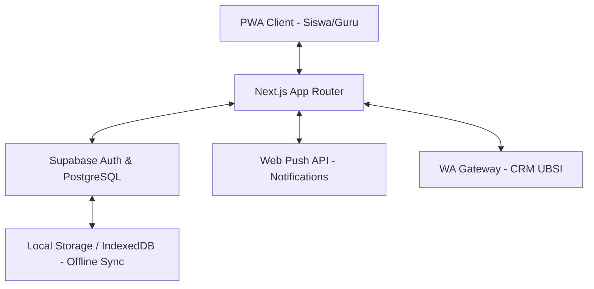

# IMPLEMENTATION PLAN (IPD)

**Nama Produk:** Nutri Kampus Hub (MBG & Smart EdTech CRM)
**Versi:** 1.0 (Development Blueprint)
**Status:** Build Mode Initiated

---

## Phase 1: Technical Blueprint

### 1.1 Tech Stack Recommendations
*   **Frontend:** Next.js 15 (App Router) + Tailwind CSS v4 (untuk performa & utility modern).
*   **UI/UX:** Framer Motion (animasi Glassmorphism) + Shadcn/UI (komponen dasar).
*   **Backend & DB:** Supabase (PostgreSQL) - Auth, Realtime Database, dan Storage.
*   **State & Data:** TanStack Query (React Query) untuk caching & Optimistic UI.
*   **PWA:** `next-pwa` + Service Workers (Offline-First & Web Push).
*   **Reporting:** `react-pdf` (untuk export PDF) + `xlsx` (untuk export Excel).

### 1.2 System Architecture

### 1.3 Database Schema (PostgreSQL)
Mengacu pada PRD v1.2, tabel utama:
1. `schools`, `classes`, `students` (Master Data).
2. `organoleptic_tests` (Harian - Guru).
3. `daily_attendances` (Rekap Kelas - Bagian B).
4. `student_mbg_logs` (Detail per Siswa - Anti Fraud).
5. `crm_campaigns` & `crm_click_logs` (Leads UBSI).

---

## Phase 2: Development Timeline & Milestones

### Minggu 1: Scaffolding & Core Auth (MVP)
- [ ] Setup Next.js, Tailwind v4, & Supabase.
- [ ] Implementasi RBAC (Role-Based Access Control): Super Admin, Guru, Siswa.
- [ ] Fitur Import Dapodik (CSV/Excel).

### Minggu 2: Core MBG Loop (2-Click System)
- [ ] Dashboard Guru: Tombol "MBG Datang" + QR Generator.
- [ ] Dashboard Siswa: QR Scanner + Checklist Kehadiran Otomatis.
- [ ] Logic Idempotency: Mencegah double-claim porsi.

### Minggu 3: Reporting & Asset Accountability
- [ ] Modul Uji Organoleptik + Foto Sampel.
- [ ] Rekonsiliasi Ompreng (Utuh/Rusak/Hilang).
- [ ] Export Laporan PDF/Excel (Formulir Resmi MBG).

### Minggu 4: CRM Integration & Optimization
- [ ] Smart Banner UBSI (Lead Scoring & Major Matching).
- [ ] Integrasi WA Gateway PMB.
- [ ] PWA Optimization (Service Workers, Offline-First, PWA Installable).

---

## Phase 3: Potential Challenges & Solutions

| Challenge | Solution |
| :--- | :--- |
| **Koneksi Internet Buruk** | Implementasi **Optimistic UI** & **Background Sync** menggunakan IndexedDB agar data tersimpan lokal saat offline. |
| **Fraud Pengambilan Porsi** | Kombinasi **Dynamic Master QR** (refresh tiap menit) dan **PIN 4-Digit** sebagai cadangan validasi area. |
| **Privasi Data Siswa** | Enkripsi data sensitif di level DB dan implementasi **Data Consent Popup** sesuai UU PDP. |

---

## Phase 4: Quality & Security Review
*   **Performance:** Target LCP < 2.5s pada jaringan 3G.
*   **Security:** Supabase Row Level Security (RLS) untuk memastikan Guru hanya bisa akses data sekolahnya sendiri.
*   **Scalability:** Arsitektur Serverless Next.js memungkinkan penanganan ribuan sekolah secara konkuren.
